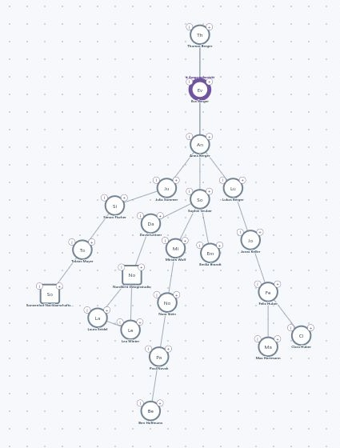
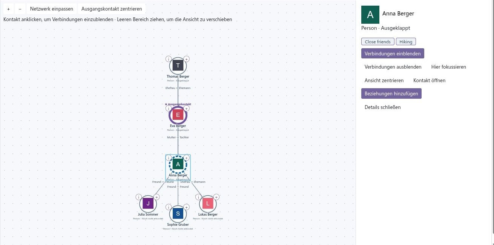

# Personal CRM for Odoo 20

## Explore relationships visually

The network shows current relationships as an interactive graph. **Full network**
reveals all accessible connections; select a contact to inspect its connections,
focus the view, or add another relationship. These screenshots use fictional
demo contacts and the German interface.

*The complete network links 22 contacts through 23 relationship records.*

*Selecting a contact opens its details and network actions beside the graph.*

## Contacts and interface

- People, companies, and authorities have dedicated list, kanban, search, and form views.
  Explicit action bindings and contextual partner navigation keep links in the
  corresponding Personal CRM person/company form.
- Pictures use standard `image_1920`/`avatar_128` storage and native Odoo widgets,
  shared with the ordinary Contacts app.
- `personal_crm_contact` marks managed contacts; the app's actions default it.
- `personal_crm_entity_type` explicitly distinguishes people from companies and
  authorities. Organizations need no VAT number. Odoo 20's tax-derived
  `is_company` remains unchanged; ordinary unflagged contacts retain that native
  classification. Relationship constraints and CRM navigation use the explicit
  kind for managed contacts.
- Person forms include `personal_crm_birthdate` and `personal_crm_gender`.
- `personal.crm.note` has a date, title, sanitized HTML body, multiple contacts/relationships,
  and standard timestamps. Notes can be added from unsaved contact forms.
- The Network smart button opens a contact's connections. The Relationships
  menu lists stored records; remove the Current filter to browse ended/future
  connections, and use Archived for archived records.

## Native relationships

Use **Add relationships** from the Relationships list or the network
diagram to connect one person to several contacts with one type and optional
dates. Network entry points prefill the starting contact; network
pair and drag actions prefill the second contact too. Changing the type keeps
selected contacts visible and shows incompatible or overlapping choices before
save. The batch is created in one transaction. Open a saved relationship in the
detailed editor to change its dates, role assignment, or shared notes. The
Network tab follows the lighter contact tabs and loads only when opened.

Models are `personal.crm.relationship` and `personal.crm.relationship.type`.
See [the relationship design](docs/RELATIONSHIPS.md) for schema, validation, and search details.

A type defines roles, not genders. The seeds are Friend, Spouse, Partner, Sibling,
Parent/Child, Grandparent/Grandchild, and Employment. There are no separate Child,
Mother, Father, Brother, Sister, Grandfather, or Grandmother relationship types.

| Type | First person's gender | Second person's gender | Displayed roles |
| --- | --- | --- | --- |
| Parent / Child | Female | Male | Mother → Son |
| Parent / Child | Female | Female | Mother → Daughter |
| Parent / Child | Male | Male | Father → Son |
| Parent / Child | Male | Female | Father → Daughter |
| Sibling | Female | Male | Sister ↔ Brother |
| Sibling | Unknown/unset | Female | Sibling ↔ Sister |

Gender is stored once on `res.partner.personal_crm_gender`. Both endpoints choose
their label independently. Empty and Unknown values use the neutral
role. Changing a person's gender refreshes all role labels, including historical
relationships; gender is not copied or inferred from a relationship.

For asymmetric types, tick **First contact has the second role** when creating a
relationship from the second role's contact—for example, adding a mother from a
son's contact. The preview shows Son → Mother, and saving normalizes the edge to
Parent → Child. Reverse entry cannot create a second copy of the same edge.
Symmetric types use the same role vocabulary on both sides and hide this option.

Type selection searches both neutral and gendered labels: searching “Mother”
finds Parent/Child; searching “Brother” finds Sibling. Additional types and gender
label overrides can be configured under Relationship types.

The module supports directed/inverse and symmetric relationships,
person/company and tag restrictions, optional self-links, date validation,
archive/unarchive, overlap checks, endpoint/type/date/tag searches, and
restrict/ignore/end/delete policies for changes to type restrictions.

## Security

Assign **Personal CRM User** in the Personal CRM privilege. Installation grants
it to `base.user_admin`; other users must be assigned deliberately. It implies
internal user and partner-manager permissions. Authorized users share Personal
CRM records; this is not an owner-isolated vault.

Flagged contacts, notes, and relationships exclude
unauthorized internal users, portal users, and the public. Gender/birthdate fields
have field groups. Relationship rules also require read access to both contacts,
so ordinary company restrictions apply. Partner classification integrity checks
use a narrow sudo read and return only a generic validation error.

## Demo data

Demo data contains 15 fictional people with gender/birthdate/address data, five
fictional companies/authorities, seven canonical relationships, and one shared note.

## Relationship network

People and company forms include a **Network** tab and a **Network** smart
button. The Relationships list/form workflow remains in the menu.
The tab starts at depth 1; the smart button opens a fresh dedicated viewer at
depth 2. Save a new contact before using its network.

Click a contact to expand its connections in place. The inspector offers
Collapse connections, Focus here, Center view, Open contact, and Add relationship.
Focus changes and Full network create Back/Forward entries. Expansions accumulate;
collapsing withdraws only branches that no surviving expanded path supports.
Changing depth preserves manually explored connecting paths. Reset removes manual
choices. Return to original contact focuses the contact whose form launched the
journey. Search distinguishes visible contacts from other accessible CRM contacts.

The graph includes current relationships using the model's inclusive date logic.
Type filters affect both connections and reachability. Each contact appears once;
parallel relationships group by unordered contact pair. Select a connection to
inspect its records, reveal individual connections, edit, end, archive, or delete
one specific record. Shared notes open in the existing note editor. **Stored
relationships** includes historical, future, and archived records; pair inspection
also offers navigation to all records for that pair. Restore remains available
through Odoo's conventional archive/unarchive interface and existing validation.

Creation uses one inherited native relationship form, including contact search,
dates, notes, and role previews. Inline creation/editing opens a dialog; dedicated
creation/editing uses the side panel. The node's **+** handle supports dragging to
another node; clicking it offers the same editor. For asymmetric types, a unique
valid orientation is selected automatically; ambiguous roles require a choice.
Save failures keep the native editor and entered values intact. A newly saved
eligible connection is revealed without expanding the new participant's other
connections. Saved records outside graph eligibility remain accessible through a
notification action. End asks for a date and preserves `active`; ending today
keeps the relationship current through today. Delete confirms the exact record.

**Continue in dedicated viewer** copies the inline journey, including history,
filters, selection, connection grouping, positions, and viewport. Dedicated changes
are independent. Exploration is kept only in browser memory and Odoo action-local
state; a page reload may initialize a fresh journey. Back/Forward always read live
relationship data, so earlier snapshots never resurrect edited/deleted records.

### Implementation

- Contacts, relationships, types, notes, and validations use the module's models.
- `models/network.py` provides authorized, capped live network reads and two
  nonstored editor fields. It uses the caller's ORM access, never `sudo`.
- `static/src/network/state.js` handles serializable exploration snapshots,
  connection grouping, geometry, and stable node placement.
- `static/src/network/network.js` implements the shared Owl viewer, inspectors,
  viewport gestures, history, cancellation, and native form integration.
- `network.xml` and `network.scss` provide responsive embedded/dedicated displays.
  Companies use square nodes and people circular nodes; focal/selected states
  also use shape, text, and line patterns rather than color alone.
- The feature depends only on Community `base`, `contacts`, and `web`. No external graph or npm dependency is needed.
- The dedicated network editor is an inherited primary view.

Full-network retrieval is atomic from the browser's perspective. Cancellation
invalidates the pending result; server-side work can finish within its hard caps,
but cancelled/failed/warning results never replace the preceding graph or acquire
a complete label. Successful Full network is a reversible history state.

Thresholds are module constants in `models/network.py`: warn above 100 contacts or
250 relationship records; reject above 500 contacts, 2,000 relationship records,
or 500 traversal rounds. Confirmation retries the complete operation with warning
thresholds waived, while retaining hard limits. No numeric progress is fabricated.

Background dragging pans; controls zoom, fit, or center without changing focus.
Dedicated graphs support wheel zoom and background pinch gestures. Inline graphs
preserve vertical page scrolling; use the zoom buttons or Ctrl+wheel there.
Contact and connection actions support keyboard Enter/Space and explicit buttons.
The **i** button opens contact details without expanding; **+** starts creation.
Collapsing a branch during Full network preserves other full-scope expansions
and withdraws the complete indicator until the full component is re-established.

## License

Copyright (c) 2026 Martin Melmuk. The module source is licensed under
LGPL-3.0 only; see [LICENSE](LICENSE). `static/description/icon.svg` is
excluded from that license and remains all rights reserved.
